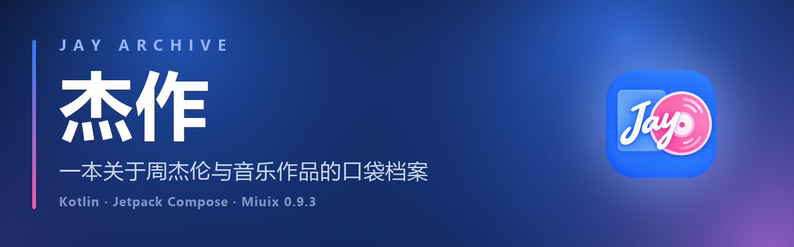
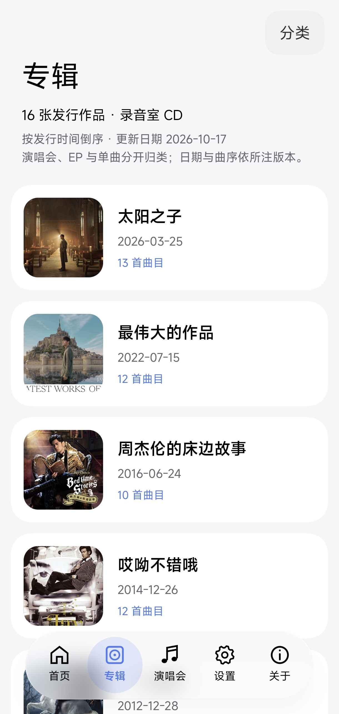
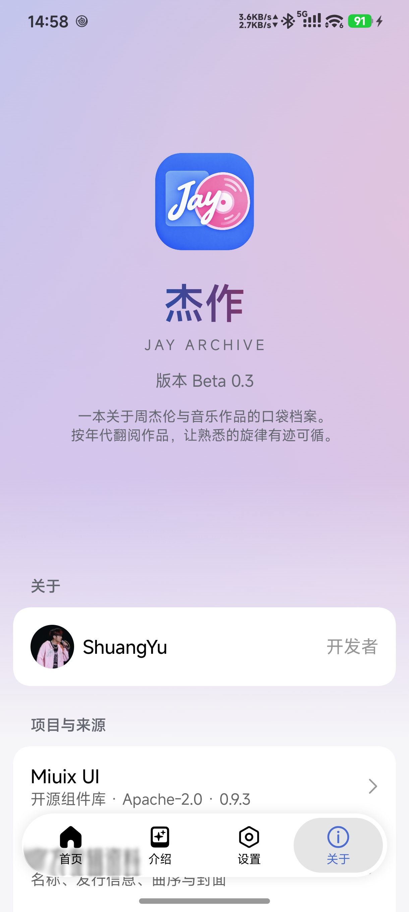
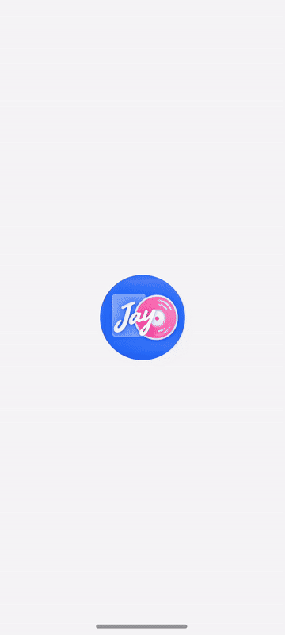

<div align="center">



# 杰作 · Jay Archive

**一本关于周杰伦与音乐作品的口袋档案** · 原生 Android 应用

[](https://developer.android.com/about/versions/oreo)
[](https://kotlinlang.org)
[](https://developer.android.com/jetpack/compose)
[](https://github.com/compose-miuix-ui/miuix/tree/v0.9.3)
[](https://github.com/suqi8/coui)

[](LICENSE)
[](https://github.com/ShuangYu1145/Jay-Archive/stargazers)

[下载安装](#-下载安装) · [界面风格](#-三种界面风格) · [功能特性](#-功能特性) · [本地构建](#-本地构建)

</div>

以 Kotlin 与 Jetpack Compose 构建，提供 **Miuix、ColorOS（COUI）、Material Design 3** 三种界面风格。收录 16 张录音室专辑、175 首曲目，另附 26 个扩展发行版本与 170 首对外作曲作品；支持目录浏览、专辑与歌曲搜索、歌词阅读及巡演行程查询。

> 这是非官方粉丝档案应用，目录文字可离线阅读，不提供音乐播放或下载。

## 📥 下载安装

前往 [GitHub Releases](https://github.com/ShuangYu1145/Jay-Archive/releases) 选择适合的 APK，支持 **Android 8.0 / API 26 及以上**。

应用内可在设置中手动检查更新，也可开启自动检查、选择是否接收测试版更新。覆盖安装时需保持签名一致；自行构建与发布的签名说明见[更新发布指南](docs/updates.md)。

## 📱 界面预览

<table align="center">
  <tr>
    <td align="center" width="25%">
      <br />
      <sub><b>首页</b> · 作品概览</sub>
    </td>
    <td align="center" width="25%">
      <br />
      <sub><b>专辑</b> · 横向列表</sub>
    </td>
    <td align="center" width="25%">
      <br />
      <sub><b>关于</b> · 项目与来源</sub>
    </td>
    <td align="center" width="25%">
      <br />
      <sub><b>动效</b> · 启动演示</sub>
    </td>
  </tr>
</table>

## 🎨 三种界面风格

在 **设置 → 主题风格 → 界面风格** 中切换，无须重启应用。三种风格共用目录、搜索与歌词功能，深浅色、动态配色、自定义颜色和专辑布局分别保存，切回时恢复各自的外观设置。

| 风格 | 界面特点 |
| :-- | :-- |
| **Miuix** | 使用 Miuix 组件，保留圆角卡片、按压反馈与玻璃材质；支持高斯或渐变顶部模糊。 |
| **ColorOS（COUI）** | 使用 COUI 主题与组件，采用超椭圆表面、分组设置、圆形操作按钮和分体悬浮底栏。 |
| **Material Design 3** | 使用 AndroidX Material 3 组件，提供原生导航、卡片、设置控件与动态配色。 |

### ColorOS（COUI）风格

- **统一的磨砂材质**：工具栏按钮与 COUI 悬浮底栏共用背景采样、半透明表面、细描边和柔和阴影，适配浅色与深色主题。
- **固定的介绍栏**：专辑、演唱会、作曲标签固定在页面顶部，列表滚动与左右切页时保持原位，右侧操作随当前分区切换。
- **自然的顶部过渡**：开启模糊后，介绍页与专辑详情页的顶部渐变模糊向下淡出，按钮阴影保留完整的扩散空间。
- **分体悬浮底栏**：关闭「液态玻璃」并保留「悬浮底部栏」时，呈现两侧圆形入口与中间胶囊组成的 COUI 底栏；也可切换标准底栏或启用液态玻璃。
- **配套控件**：设置分组、开关、分类面板、颜色选择器与弹窗使用 COUI 组件，主题色和按压反馈随风格统一。

三种风格均可在应用支持的 Android 设备上选择。真实背景模糊与液态玻璃需要 Android 13+；旧系统保留实色表面和基本交互。更多说明见[界面风格](docs/ui-styles.md)与 [COUI 接入说明](docs/coui-ui.md)。

## ✨ 功能特性

| 功能 | 说明 |
| :-- | :-- |
| 📚 专辑档案 | 16 张录音室专辑、175 首曲目；26 个扩展发行版本、229 首曲目。展示发行日期、完整曲序、封面、版本说明与来源链接。 |
| 🗂 分类与布局 | 录音室、演唱会、EP、单曲、原声与其他发行可多选筛选；支持横向列表、双列网格、大封面卡片，分别记忆滚动位置。 |
| 🔍 专辑与歌曲搜索 | 按原名、本地化名称及歌曲名搜索，点击歌曲可进入对应专辑并定位曲目。 |
| ✍️ 对外作曲 | 独立收录 170 首为其他歌手创作的作品，支持歌名、歌手、发行名称与年份组合搜索，查看创作人员及来源。 |
| 📖 歌词阅读 | 在线匹配原文与翻译，支持导入 LRC / TXT；提供字号、行距等阅读设置，未预装商业歌曲歌词。 |
| 🎤 巡演行程 | 最近场次倒计时、巡演日历及国家／城市／状态筛选；详情提供当地时间、时区、场馆、地图与票务来源。联网核对官方行程，离线使用随包快照。 |
| 🖼 个性化外观 | 深浅色跟随系统，支持 Monet 动态配色、自定义种子色、本地背景图片与可选卡片模糊。 |
| 🌐 多语言 | 支持简体中文、繁体中文、英语、日语与韩语，默认跟随系统，也可单独选择应用语言。 |
| 🔄 应用更新 | 支持手动与自动检查 GitHub Releases，可选择接收测试版；下载交由浏览器处理。 |

对外作曲目录独立统计，不计入个人专辑曲目数，也不宣称覆盖全部作品。目录范围与版本说明见[对外作曲目录](docs/compositions.md)。

## 🫧 视觉与交互

- **页面导航**：首页、介绍、设置、关于四个一级页面可点按或横滑切换；介绍页包含专辑、演唱会与作曲。宽屏使用侧栏导航。
- **导航材质**：三种风格均支持标准底栏、悬浮底栏与可选液态玻璃；液态玻璃模式下，选中胶囊可随拖动伸缩并吸附到目标页面。
- **卡片原位展开**：专辑封面从列表中的真实位置展开为详情，返回时反向收回；通过图层保留封面，不在主线程截取 Bitmap。
- **预测性返回**：支持的系统上可随返回手势预览详情关闭过程，取消手势后恢复当前详情。

| 能力 | 生效条件 | 不满足条件时 |
| :-- | :-- | :-- |
| 背景模糊 | Android 13+，相关模糊选项开启 | 使用实色表面，保留基本交互 |
| 液态玻璃导航 | Android 13+，悬浮底栏与液态玻璃开启 | 使用当前风格的普通导航栏 |
| Monet 动态配色 | Android 12+，动态配色开启 | 使用已保存的自定义色或风格默认色 |
| 应用内预测性返回 | Android 14+，手势导航与对应开关开启 | 使用常规详情退出过渡 |

## 🛠 本地构建

**环境要求**

- Android Studio，支持项目使用的 AGP **9.4.1**。
- **JDK 25** 作为 Gradle Daemon JVM；版本已在 `gradle/gradle-daemon-jvm.properties` 中固定。
- **Android SDK Platform 37** 与 **Build Tools 36.0.0**。
- 运行或设备测试需要 Android 8.0 / API 26 及以上的设备或模拟器。

在 `local.properties` 中配置 `sdk.dir`，然后同步项目。首次构建需要访问 Google Maven、Maven Central 与 Gradle 分发站点。

```bash
./gradlew :app:assembleDebug                 # 构建可安装的 Debug APK
./gradlew :app:assembleRelease               # 构建 Release APK，正式发布需配置签名
./gradlew :app:testDebugUnitTest             # 单元测试
./gradlew :app:lintDebug                     # 静态检查
./gradlew :app:connectedDebugAndroidTest     # 设备端界面测试
```

Windows 下将 `./gradlew` 替换为 `.\gradlew.bat`。

- Debug APK：`app/build/outputs/apk/debug/app-debug.apk`
- Release 输出目录：`app/build/outputs/apk/release/`
- 更新元数据：`app/build/outputs/updates/update.json`，随 APK 构建自动生成。

<details>
<summary><b>技术栈与工程结构</b></summary>

| 项目 | 当前配置 |
| :-- | :-- |
| Gradle / AGP | 9.6.0 / 9.4.1 |
| Kotlin / Compose Compiler | 2.4.20 / 2.4.20 |
| AndroidX Compose UI、Foundation、Animation | 1.11.2 |
| Miuix UI / Blur / Preference | 0.9.3 |
| COUI UI / Preference | 1.1.0 |
| Material Design 3 | 1.4.0 |
| Activity / Lifecycle Compose | 1.12.4 / 2.10.0 |
| Preferences DataStore / Coil Compose | 1.2.1 / 2.7.0 |
| compileSdk / targetSdk / minSdk | 37 / 37 / 26 |
| Build Tools / Java 字节码 | 36.0.0 / 17 |

依赖版本集中在 `gradle/libs.versions.toml`。AGP 使用内置 Kotlin 支持，根构建文件对齐 KGP 与 Compose Compiler 版本。

```text
app/src/main/
├─ assets/                  # 专辑、扩展发行、对外作曲及多语言目录
└─ java/love/yu/jaychou/
   ├─ MainActivity.kt       # 入口、设置与系统栏
   ├─ data/                 # 目录、歌词、行程、设置与更新数据
   ├─ navigation/           # 页面宿主、详情导航与预测返回
   └─ ui/
      ├─ screens/           # 首页、介绍、专辑、演唱会、作曲、歌词、设置、关于
      ├─ designsystem/      # Miuix / COUI / Material 3 组件适配
      ├─ components/        # 共用顶栏、按钮、图片与资料组件
      ├─ navigation/        # 标准底栏、悬浮导航与侧栏
      ├─ animation/         # 封面展开与启动动效
      ├─ effects/           # 背景采样、渐变模糊与液态玻璃
      ├─ theme/             # 三种风格的主题与配色
      └─ updates/           # 更新设置与弹窗
app/src/test/               # 数据、搜索、设置及模型测试
app/src/androidTest/        # 导航、界面风格、搜索与渲染回归测试
docs/                       # 功能说明、横幅、截图与演示
scripts/                    # 目录抓取、本地化生成与交付辅助脚本
```

模糊模块仅在 Android 13+ 创建 backdrop 和 shader 对象。背景采样与前景控件分层绘制，避免将按钮、导航栏自身采样回背景；低版本使用实色降级。目录抓取脚本不参与应用构建。

</details>

## 📚 资料与说明

- **目录来源**：专辑目录、封面与日期取自 JVR、QQ 音乐、Apple Music 等资料，保留来源链接与原始时间戳。个人专辑目录核对日期为 **2026-10-17**；来源存在版本或日期分歧时，在详情中注明。
- **离线范围**：专辑与作曲目录文字随应用提供，可离线阅读；封面与人物照通过 Coil 联网加载并缓存，不在 APK assets 中打包离线副本。加载失败时显示矢量占位图与「图片加载失败 · 点此重试」。
- **歌词来源**：在线歌词通过[落月 API 的 QQ 音乐歌词接口](https://doc.vkeys.cn/v2/%E9%9F%B3%E4%B9%90%E6%A8%A1%E5%9D%97/QQ%E9%9F%B3%E4%B9%90/8-lyric.html)匹配周杰伦版本，区分现场与录音室版本；不保证所有歌曲都有在线歌词，请自行核对。
- **行程来源**：巡演资料参考 [JVR 官方行程](https://www.jvrmusic.com/activity/list/1150822038412333056)、[维基百科](https://zh.wikipedia.org/wiki/%E5%98%89%E5%B9%B4%E8%8F%AFII%E4%B8%96%E7%95%8C%E5%B7%A1%E8%BF%B4%E6%BC%94%E5%94%B1%E6%9C%83)及各站票务公告。票价、开票时间与售票状态仅在来源明确公布时显示，最终以主办方和票务平台为准。
- **项目性质**：本项目与周杰伦本人、杰威尔音乐及任何唱片公司无关联。封面、人物照片、歌词与商标版权归各自权利人所有，仅作资料展示。

功能与维护文档：[界面风格](docs/ui-styles.md) · [COUI 接入](docs/coui-ui.md) · [对外作曲](docs/compositions.md) · [多语言](docs/localization.md) · [主打曲目](docs/lead-tracks.md) · [更新发布](docs/updates.md)。

## ⚖️ 许可与致谢

代码以 [Apache License 2.0](LICENSE) 开源。感谢 [Miuix UI](https://github.com/compose-miuix-ui/miuix)、[COUI](https://github.com/suqi8/coui)、[Material Design 3](https://developer.android.com/jetpack/androidx/releases/compose-material3)、[Jetpack Compose](https://developer.android.com/jetpack/compose) 及[落月 API](https://doc.vkeys.cn/v2/%E9%9F%B3%E4%B9%90%E6%A8%A1%E5%9D%97/QQ%E9%9F%B3%E4%B9%90/8-lyric.html)提供的组件与服务。

<div align="center">

**献给我们的青春**

<sub>Made with ❤️ for Jay Chou's music · 非官方项目</sub>

</div>
